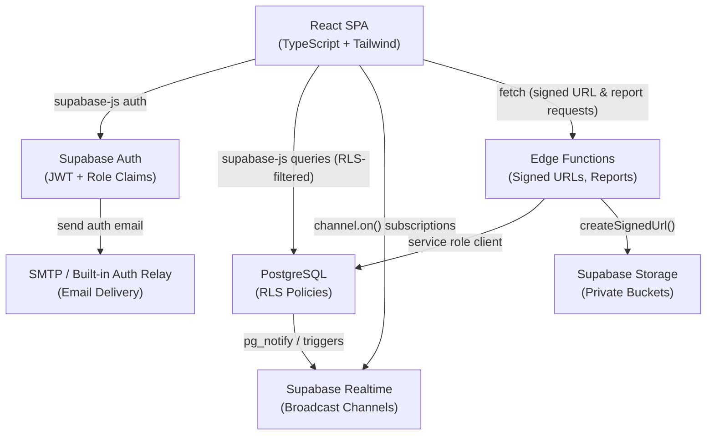
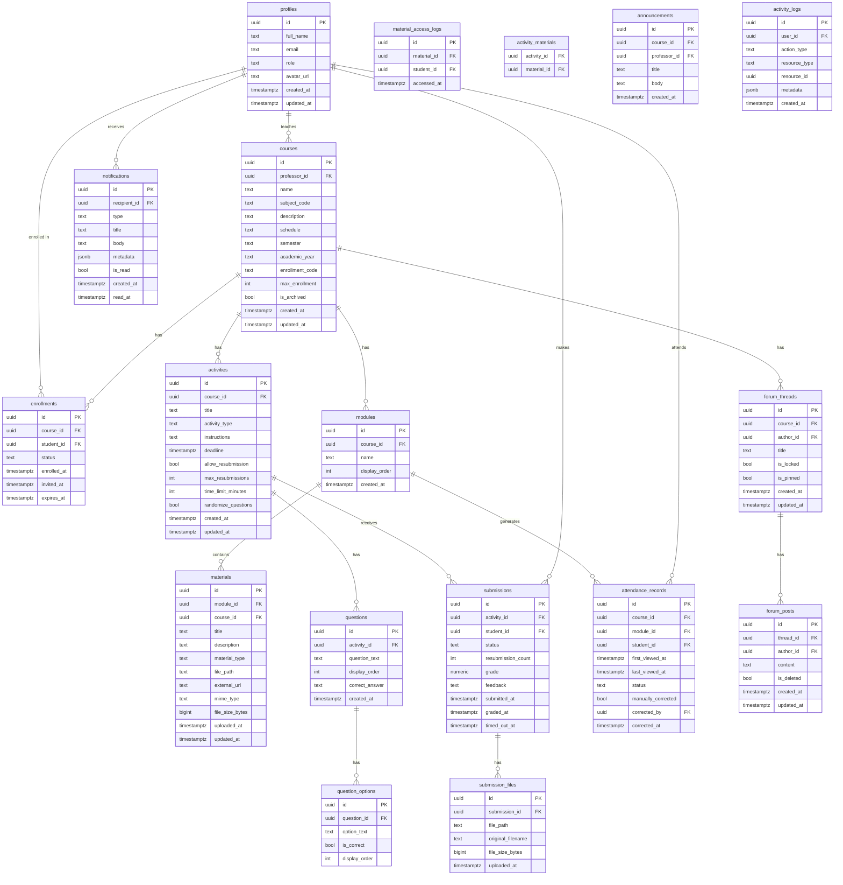

# Design Document

## Overview

The LMS is a web-based academic platform for colleges and universities. It centralizes course management, learning materials, activities, attendance monitoring, and reporting. Two authenticated roles — Professor and Student — each have dedicated dashboards and permission boundaries enforced both at the application layer and the database layer via PostgreSQL Row Level Security (RLS).

The system is a React + TypeScript single-page application backed entirely by Supabase (PostgreSQL, Auth, Realtime, and Storage). Student attendance is automatically recorded once a student views a course module. All real-time events (notifications, forum posts) are delivered through Supabase Realtime channels using the Postgres CDC broadcast pattern.

**Key architectural decisions:**

| Decision | Choice | Rationale |
|---|---|---|
| Attendance tracking | Automatic module view tracking (`attendance_records` keyed by `(module_id, student_id)`) | Eliminates third-party video conferencing overhead; attendance is recorded as "Present" immediately once an enrolled student views a module |
| Auth strategy | Supabase Auth + Custom JWT claims for role | Roles stored in `app_metadata`; a Custom Access Token Hook injects `role` into the JWT, enabling RLS policies that use `auth.jwt()->'role'`; [Supabase RBAC docs](https://supabase.com/docs/guides/api/custom-claims-and-role-based-access-control-rbac) |
| File access | Private Supabase Storage buckets + short-lived signed URLs | Prevents public URL enumeration; every download requires a fresh signed URL generated server-side; [Supabase Storage docs](https://supabase.com/docs/guides/storage/buckets/fundamentals) |
| Real-time delivery | Supabase Realtime Broadcast via Postgres triggers | Database triggers post to Broadcast channels; React clients subscribe on mount; [Supabase Realtime guide](https://supabase.com/docs/guides/realtime) |
| State management | React Query (TanStack Query) + Zustand | React Query handles server state and cache invalidation; Zustand manages ephemeral UI state |
| Email delivery | Supabase Auth built-in SMTP (free tier) | Supabase's free tier includes transactional email via its built-in SMTP relay for auth emails (password reset, invites); no third-party email service required at zero cost |
| Frontend hosting | Vercel Hobby (free) | Unlimited personal projects, automatic HTTPS, global CDN, preview deployments — no cost for non-commercial use |

**Free tier limits to stay within:**

| Service | Free tier allowance | Design stay-within target |
|---|---|---|
| Supabase DB | 500 MB database space | Schema is normalized; large data (files) stored in Storage, not DB |
| Supabase Storage | 1 GB storage | Materials bucket enforces 500 MB/file client-side; total project data expected well under 1 GB in dev/staging |
| Supabase Auth | 50,000 MAU | Well within range for a university LMS prototype |
| Supabase Edge Functions | 500,000 invocations/month, 10 ms CPU/invocation | 2 edge functions used; invocations driven by user actions, not background polling |
| Supabase Realtime | 200 concurrent connections, 2 million messages/month | Each browser tab opens ≤ 2 channels; acceptable for a class-sized deployment |
| Vercel Hobby | Unlimited deployments, 100 GB bandwidth/month | Static SPA; well within bandwidth limits |

---

## Architecture

The application follows a client-centric architecture where the React SPA communicates directly with Supabase through the `supabase-js` client. A lightweight Supabase Edge Function layer handles operations that must run server-side: generating signed URLs and exporting reports.



### Deployment Model

| Layer | Technology | Hosting | Cost |
|---|---|---|---|
| Frontend | React + Vite | Vercel Hobby | **Free** |
| Backend | Supabase project | Supabase Cloud Free tier | **Free** |
| Edge Functions | Deno runtime | Supabase Edge Functions (free tier) | **Free** |
| Email | Supabase Auth built-in SMTP | Included in Supabase free tier | **Free** |

> **Note on email:** Supabase's free tier includes its own SMTP relay for auth-triggered emails (password reset, magic links, invitations). For application-level notifications (new material, grade released, announcement posted), those are delivered as **in-app notifications only** via Supabase Realtime — no outbound email service is needed, keeping the stack entirely within free tiers.

---

## Components and Interfaces

### Frontend Component Tree

```
src/
├── App.tsx                         # Router + Auth context provider
├── lib/
│   ├── supabaseClient.ts           # Supabase JS client singleton
│   └── queryClient.ts              # TanStack Query client config
├── hooks/
│   ├── useAuth.ts                  # Current user + role
│   ├── useNotifications.ts         # Realtime notification subscription
│   └── useRealtimeChannel.ts       # Generic Realtime hook
├── pages/
│   ├── auth/                       # Login, Logout, PasswordReset
│   ├── dashboard/                  # ProfessorDashboard, StudentDashboard
│   ├── courses/                    # CourseList, CourseDetail, CourseCreate
│   ├── materials/                  # ModuleView, MaterialUpload
│   ├── activities/                 # ActivityList, ActivityCreate, SubmissionView
│   ├── attendance/                 # AttendanceHistory, StudentAttendance
│   ├── grades/                     # GradeBook, StudentGrades
│   ├── forums/                     # ForumList, ThreadView
│   ├── calendar/                   # AcademicCalendar
│   ├── reports/                    # AnalyticsDashboard, ReportDownload
│   └── profile/                    # ProfilePage
├── components/
│   ├── layout/                     # AppShell, Sidebar, MobileDrawer, Navbar
│   ├── notifications/              # NotificationCenter, NotificationBadge
│   ├── activities/                 # ActivityCard, SubmissionForm, QuizPlayer
│   ├── ui/                         # Button, Input, Modal, Badge, Table (Tailwind variants)
│   └── guards/                     # AuthGuard, RoleGuard
└── edge-functions/
    ├── generate-signed-url/        # POST /generate-signed-url
    └── export-report/              # POST /export-report (CSV / XLSX)
```

### Key React Component Interfaces

```typescript
// AuthGuard — wraps protected routes
interface AuthGuardProps {
  children: React.ReactNode;
  requiredRole?: 'professor' | 'student';
}

// ModuleView — records student attendance when a student views a module
interface ModuleViewProps {
  courseId: string;
  moduleId: string;
  onModuleViewed?: (moduleId: string, studentId: string) => Promise<void>;
}

// NotificationCenter
interface NotificationCenterProps {
  userId: string;
  onMarkRead: (notificationId: string) => void;
}

// SubmissionForm
interface SubmissionFormProps {
  activityId: string;
  deadline: Date;
  allowResubmission: boolean;
  maxResubmissions: number;
  existingSubmission?: Submission;
  onSubmit: (files: File[], textAnswer?: string) => Promise<void>;
}
```

### Edge Function Contracts

**`POST /generate-signed-url`** — Called by authenticated clients to get a time-limited download URL.
```typescript
// Request
{ objectPath: string; expiresIn?: number /* seconds, default 3600 */ }
// Response
{ signedUrl: string; expiresAt: string }
```

**`POST /export-report`** — Generates and returns a CSV or XLSX download.
```typescript
// Request
{ courseId: string; format: 'csv' | 'xlsx';
  filters: { studentId?: string; moduleId?: string; dateRange?: [string, string]; semester?: string } }
// Response: file stream with Content-Disposition header
```

> **Note:** The `send-notification-email` edge function is removed from the design. Notification emails are replaced entirely by in-app Supabase Realtime notifications to stay within the free tier. The `send-notification-email` directory and edge function are not implemented.

---

## Data Models

### Entity Relationship Diagram



### Key Column Constraints and Defaults

```sql
-- profiles.role: CHECK (role IN ('professor', 'student'))
-- courses.enrollment_code: UNIQUE, generated as 8-char alphanumeric
-- enrollments.status: CHECK (status IN ('active', 'pending', 'expired'))
-- activities.activity_type: CHECK (activity_type IN (
--   'assignment', 'quiz', 'exam', 'essay', 'short_answer',
--   'multiple_choice', 'file_submission', 'group_project'))
-- submissions.status: CHECK (status IN (
--   'submitted', 'late', 'graded', 'missing', 'timed_out'))
-- attendance_records: UNIQUE (module_id, student_id), status CHECK (status IN (
--   'present', 'absent', 'excused'))
-- notifications: max 100 per user enforced via a trigger + delete oldest on insert
```

### Storage Bucket Layout

All buckets are **private**. Access requires a server-side signed URL.

| Bucket | Path pattern | Contents |
|---|---|---|
| `avatars` | `{userId}/avatar.{ext}` | Profile photos |
| `materials` | `{courseId}/{moduleId}/{materialId}/{filename}` | Course files |
| `submissions` | `{courseId}/{activityId}/{studentId}/{submissionId}/{filename}` | Student submission files |

### RLS Policy Summary

Every table in the `public` schema has RLS enabled. Representative policies:

```sql
-- courses: professors see/edit only their own; students see courses they're enrolled in
CREATE POLICY "professor_owns_course" ON courses
  USING (professor_id = auth.uid());

CREATE POLICY "student_enrolled_course" ON courses
  FOR SELECT USING (
    EXISTS (
      SELECT 1 FROM enrollments
      WHERE enrollments.course_id = courses.id
        AND enrollments.student_id = auth.uid()
        AND enrollments.status = 'active'
    )
  );

-- submissions: student sees/edits only their own
CREATE POLICY "student_owns_submission" ON submissions
  USING (student_id = auth.uid());

-- notifications: user sees only their own
CREATE POLICY "user_owns_notification" ON notifications
  USING (recipient_id = auth.uid());
```

---

## Correctness Properties

*A property is a characteristic or behavior that should hold true across all valid executions of a system — essentially, a formal statement about what the system should do. Properties serve as the bridge between human-readable specifications and machine-verifiable correctness guarantees.*

### Property 1: Enrollment code uniqueness

*For any* two distinct courses in the system, their enrollment codes shall be different — the enrollment code generator shall never produce a duplicate that already exists in the `courses` table.

**Validates: Requirements 3.1**

---

### Property 2: Submission status classification

*For any* activity and any submission, the status derived by the classifier shall satisfy all of the following simultaneously: status is `late` if and only if `submitted_at > deadline`; status is `submitted` or `graded` if `submitted_at <= deadline`; status is `missing` if no submission exists and `now > deadline`; status is `upcoming` if no submission exists and `now <= deadline`.

**Validates: Requirements 6.6, 7.1, 7.3, 7.8**

---

### Property 3: Resubmission count invariant

*For any* activity with `allow_resubmission = true` and `max_resubmissions = N`, the system shall never accept a submission from the same student once their `resubmission_count` has reached N — meaning the total accepted submission count per (student, activity) pair shall never exceed N + 1.

**Validates: Requirements 7.6**

---

### Property 4: Module view attendance recording idempotence

*For any* enrolled student and any module in that course, viewing the module one or more times shall result in at most one `attendance_records` entry for `(module_id, student_id)` with `status = 'present'`, where `first_viewed_at` equals the timestamp of the initial view and `last_viewed_at` equals the timestamp of the most recent view.

**Validates: Requirements 8.1, 8.2, 9.1**

---

### Property 5: Attendance status derivation from module views

*For any* module and any enrolled student in a course, the student's effective attendance status for that module shall be `'present'` if a view record exists (unless manually corrected to `'absent'` or `'excused'`), `'excused'` if manually set to `'excused'`, and `'absent'` if no view record exists and no manual override has been applied.

**Validates: Requirements 8.1, 8.3, 8.4**

---

### Property 6: Notification delivery completeness

*For any* triggering event in a course (new material uploaded, module published, new activity created, grade released, announcement posted), every student with an active enrollment in that course shall receive exactly one notification record of the corresponding type — the total notification count per event equals the enrollment count, with no duplicates and no omissions.

**Validates: Requirements 11.1, 11.2, 11.4, 11.7**

---

### Property 7: Quiz auto-grade correctness

*For any* quiz submission, the auto-computed score shall equal the count of questions where the student's answer, after trimming whitespace and lowercasing, exactly matches the correct answer after the same normalization — no more, no less.

**Validates: Requirements 17.3**

---

### Property 8: Notification read-state transition

*For any* notification in the `unread` state, after the mark-as-read operation completes, the notification's `is_read` shall be `true` and the recipient's unread count shall be exactly one less than before the operation.

**Validates: Requirements 11.6**

---

### Property 9: Manual attendance correction persistence

*For any* manual attendance status correction submitted by a professor, the validator shall accept it if and only if the status is in `('present', 'absent', 'excused')`, and upon saving, `manually_corrected` shall be `true` with `corrected_by` and `corrected_at` populated.

**Validates: Requirements 8.4**

---

### Property 10: Grade range invariant

*For any* grade value submitted by a professor, the validator shall accept it if and only if it is a number in the closed interval [0, 100] inclusive — values outside this range shall be rejected and no grade shall be persisted.

**Validates: Requirements 6.9**

---

### Property 11: File upload constraint validation

*For any* file upload attempt — whether a course material (max 500 MB, specific MIME types) or a student submission (max 100 MB total, max 10 files, specific MIME types) — the validator shall accept the upload if and only if every file's MIME type is in the allowed set for that context AND the total size is within the per-context limit.

**Validates: Requirements 5.1, 5.2, 7.4, 7.5**

---

### Property 12: URL validation

*For any* external URL string submitted as a course material link, the validator shall accept it if and only if the string begins with `http://` or `https://` and conforms to RFC 3986 syntax — otherwise it shall be rejected without creating a Material record.

**Validates: Requirements 5.5, 5.6**

---

### Property 13: Enrolled-only module attendance recording

*For any* student attempting to view a module, an attendance record shall be created if and only if the student has an `active` enrollment in the course owning that module — attempts by unenrolled students shall be denied and shall not create an attendance record.

**Validates: Requirements 8.1, 9.2**

---

### Property 14: Attendance percentage calculation

*For any* student in a course, the per-student attendance percentage displayed on the analytics dashboard shall equal `(count of modules in the course where student is Present or Excused) / (total modules in the course) * 100`, rounded to two decimal places (or 0 if the course has 0 modules).

**Validates: Requirements 10.1, 12.1**

---

## Error Handling

### Strategy by Layer

| Layer | Mechanism |
|---|---|
| Input validation | Zod schemas on all form inputs; field-level errors surfaced inline without clearing user input |
| Auth errors | Supabase Auth error codes mapped to user-readable messages; account lockout state stored in `app_metadata` |
| Network / Supabase errors | React Query retry policy (3 retries, exponential backoff); toast notification on final failure |
| File uploads | Client-side type/size check before upload; Storage RLS rejects unauthorized uploads with 403 |
| Edge Functions | Structured error responses `{ error: string; code: string }`; logged to Supabase Logs |
| Storage delete failures | Material record restored and error message shown (Requirement 5.11) |

### Specific Error Flows

**Account lockout (Requirement 1.2):** A Supabase Auth hook increments a `failed_attempts` counter in `app_metadata` on each failed login. After 5 failures within 15 minutes, the hook sets `locked_until` and the client displays the lockout duration. On each login attempt, the server checks `locked_until` before validating credentials.

**Password reset for unregistered email (Requirement 1.4):** The Edge Function always returns HTTP 200 with the same response body regardless of whether the email exists, preventing email enumeration.

**Enrollment code not found / expired (Requirements 4.2, 4.3):** The enrollment Edge Function queries the `courses` table with the provided code, checks active status and capacity, and returns a typed error code (`INVALID_CODE`, `EXPIRED`, `CAPACITY_REACHED`, `ALREADY_ENROLLED`) that the client maps to a specific message.

**Duplicate module view events (Requirement 8.2):** Recording attendance on module view uses an upsert (`ON CONFLICT (module_id, student_id) DO UPDATE SET last_viewed_at = EXCLUDED.last_viewed_at`) so repeated views by the same student never fail or create duplicate rows, and never overwrite a professor's manual correction.

**Report generation timeout (Requirement 12.4):** Reports are generated synchronously for datasets up to 10,000 rows. The Edge Function streams the response using the Streams API so the client receives a progressive download rather than waiting for full in-memory assembly.

---

## Testing Strategy

### Unit Tests (Vitest)

Unit tests cover pure logic that does not require a running database or network:

- Module attendance status derivation and percentage calculation (`deriveModuleAttendanceStatus`, `computeAttendancePercentage`)
- Quiz auto-grade scoring (`scoreQuizSubmission(answers, correctAnswers)`)
- Enrollment code generator (uniqueness and character set invariants)
- Zod validation schemas for all form inputs (valid and invalid cases)
- Submission status classifier (`classifySubmission(submittedAt, deadline, graded)`)
- Notification count reducer (read/unread state transitions)

### Property-Based Tests (fast-check, minimum 100 iterations each)

Each property test maps to a numbered correctness property in this document.

- **Feature: lms-platform, Property 1**: Enrollment code uniqueness — generate N course creation requests in a single batch, assert all resulting enrollment codes are distinct.

- **Feature: lms-platform, Property 2**: Submission status classification — generate random `submittedAt` / `deadline` pairs, assert `classifySubmission` returns `late` iff `submittedAt > deadline` and `submitted` iff `submittedAt <= deadline`.

- **Feature: lms-platform, Property 3**: Resubmission count invariant — generate random sequences of resubmission events for varying `max_resubmissions` values, assert the handler rejects every attempt once the count reaches the maximum.

- **Feature: lms-platform, Property 4**: Module view attendance recording idempotence — generate random sequences of module view timestamps for a `(module_id, student_id)` pair, assert exactly one attendance record exists with `status = 'present'`, `first_viewed_at` equal to the first view, and `last_viewed_at` equal to the latest view.

- **Feature: lms-platform, Property 5**: Attendance status derivation from module views — generate random combinations of view presence and manual corrections, assert `deriveModuleAttendanceStatus` returns `'present'`, `'absent'`, or `'excused'` matching the rules with no contradictions.

- **Feature: lms-platform, Property 6**: Notification delivery completeness — generate random enrollment sets and trigger events, assert the notification row count after the event equals the active enrollment count with no duplicates.

- **Feature: lms-platform, Property 7**: Quiz auto-grade correctness — generate random arrays of `(studentAnswer, correctAnswer)` pairs with varied whitespace and casing, assert `scoreQuizSubmission` equals the manually counted matches.

- **Feature: lms-platform, Property 8**: Notification read-state transition — generate random notification sets with mixed read/unread state, assert marking one unread notification as read decrements the unread count by exactly 1 and sets `is_read = true`.

- **Feature: lms-platform, Property 9**: Manual attendance correction persistence — generate random status strings, assert the validator accepts iff the value is in `('present', 'absent', 'excused')`.

- **Feature: lms-platform, Property 10**: Grade range invariant — generate random numeric values including boundary and out-of-range values, assert the validator accepts iff value is in [0, 100].

- **Feature: lms-platform, Property 11**: File upload constraint validation — generate random arrays of `(mimeType, sizeBytes)` tuples for both material and submission contexts, assert the validator accepts iff all types are in the allowed set and total size is within the context limit.

- **Feature: lms-platform, Property 12**: URL validation — generate random strings with valid and invalid URL prefixes and structures, assert the validator accepts iff the string begins with `http://` or `https://` and parses as a valid RFC 3986 URI.

- **Feature: lms-platform, Property 13**: Enrolled-only module attendance recording — generate random `(studentId, moduleId, enrollmentStatus)` tuples, assert attendance recording succeeds iff `enrollmentStatus === 'active'`.

- **Feature: lms-platform, Property 14**: Attendance percentage calculation — generate random sets of module attendance records per student per course, assert `computeAttendancePercentage(records, totalModules)` equals `(presentOrExcusedCount / totalModules) * 100`.

### Integration Tests (Vitest + Supabase local dev)

Run against a local Supabase instance (`supabase start`):

- RLS policies: verify professors cannot read other professors' courses; students cannot read unenrolled courses; students cannot read other students' submissions.
- Enrollment flow end-to-end: code generation, enrollment creation, duplicate rejection.
- Notification trigger: insert a material record and verify a notification row appears for each enrolled student.
- Storage signed URL: verify unauthenticated requests to private buckets return 403.

### End-to-End Tests (Playwright)

Cover the critical user journeys:

- Professor creates course → shares enrollment code → student enrolls → student sees course.
- Professor uploads material to a module → student views module → attendance is automatically recorded as Present → student downloads material.
- Professor creates quiz → student takes quiz → auto-grade is applied.

---

## UI Design System

The visual design is inspired by a soft, modern SaaS aesthetic: a white/light-lavender base, purple-to-blue gradient hero banners, colorful 3D-style emoji/icon illustrations on cards, and a clean left sidebar navigation. The overall feel is friendly and academic — think a polished university portal, not a corporate dashboard.

### Color Palette

| Token | Hex | Usage |
|---|---|---|
| `color-primary` | `#7C5CFC` | Primary buttons, active nav item, badges, links |
| `color-primary-light` | `#EDE9FE` | Hover states, selected row backgrounds, pill backgrounds |
| `color-gradient-start` | `#8B5CF6` | Hero banner gradient left |
| `color-gradient-end` | `#6366F1` | Hero banner gradient right |
| `color-surface` | `#FFFFFF` | Cards, modals, sidebar |
| `color-background` | `#F5F3FF` | Page background (very light lavender) |
| `color-text-primary` | `#1E1B4B` | Headings, body text |
| `color-text-secondary` | `#6B7280` | Labels, metadata, placeholders |
| `color-border` | `#E5E7EB` | Card borders, dividers, input borders |
| `color-success` | `#10B981` | "Present" badge, success toasts |
| `color-warning` | `#F59E0B` | "Late" badge, deadline warnings |
| `color-error` | `#EF4444` | "Absent" badge, error states, destructive actions |
| `color-info` | `#3B82F6` | Informational notices, "In Progress" badge |

### Typography

| Role | Font | Weight | Size |
|---|---|---|---|
| Display (hero heading) | Inter | 700 | 24px / 1.5rem |
| Page heading (H1) | Inter | 600 | 20px / 1.25rem |
| Section heading (H2) | Inter | 600 | 16px / 1rem |
| Card title | Inter | 500 | 14px / 0.875rem |
| Body / table cell | Inter | 400 | 14px / 0.875rem |
| Caption / metadata | Inter | 400 | 12px / 0.75rem |

All text uses Inter (loaded via Google Fonts CDN — free). Line height defaults to `1.5`.

### Layout

```
┌──────────────────────────────────────────────────────────┐
│  Sidebar (240px fixed, white, shadow-sm)                  │
│  ┌────────────────────────────────────────────────────┐  │
│  │  Logo / Brand (top)                                │  │
│  │  Nav items (icon + label, 48px row height)         │  │
│  │  Active item: left border 3px primary + bg-primary-light │
│  │  Upgrade / help CTA (bottom of sidebar)            │  │
│  └────────────────────────────────────────────────────┘  │
│                                                           │
│  Main content area (flex-1, bg-background, p-6)          │
│  ┌────────────────────────────────────────────────────┐  │
│  │  Top bar: search input (left) + notification bell  │  │
│  │           + user avatar (right)                    │  │
│  │                                                    │  │
│  │  Hero banner (gradient purple, rounded-2xl, p-6)   │  │
│  │  ┌──────────────────────┐  ┌────────────────────┐  │  │
│  │  │ Welcome text + CTA   │  │ 3D illustration    │  │  │
│  │  └──────────────────────┘  └────────────────────┘  │  │
│  │                                                    │  │
│  │  Section: "Courses" / "Activities" / etc.          │  │
│  │  Card grid (auto-fill, minmax 220px, gap-4)        │  │
│  │  [Card] [Card] [Card] [Card]                       │  │
│  └────────────────────────────────────────────────────┘  │
└──────────────────────────────────────────────────────────┘
```

**Responsive breakpoints:**
- `< 1024px`: Sidebar collapses to a drawer (hamburger button in top bar)
- `< 768px`: Card grid switches to 2-column, then 1-column at `< 480px`
- `>= 1024px`: Sidebar always visible

### Components

#### Sidebar Navigation
- Width: 240px, background `color-surface`, right border `color-border`
- Logo at top: 32px icon + brand name in `color-primary` bold
- Nav items: `icon (20px) + label`, 48px row, 12px horizontal padding
- Active state: `border-l-4 border-primary bg-primary-light text-primary font-medium`
- Hover state: `bg-primary-light/60`
- Section dividers between nav groups (e.g., main nav, admin, help)
- Bottom CTA card: soft purple background, "Upgrade" or help link

#### Top Bar
- Height: 64px, background `color-surface`, bottom border `color-border`
- Search bar: rounded-full, 320px wide, `bg-background`, left-padded icon
- Right cluster: notification bell with unread badge (red dot), user avatar (32px circle)

#### Hero Banner
- Background: linear-gradient `color-gradient-start` → `color-gradient-end`
- Border radius: `rounded-2xl` (16px)
- Padding: `p-6` to `p-8`
- Left side: personalized welcome heading (white) + subtitle (white/80) + "Learn more" button (white bg, primary text)
- Right side: 3D illustration (books, graduation cap, etc.) — use Lottie JSON animations or static WebP/PNG from open-source libraries (e.g., [3D icons from Spline/Figma community](https://www.figma.com/community))

#### Content Cards (Course / Material / Activity cards)
- Background: `color-surface`
- Border: 1px `color-border`, `rounded-xl`
- Shadow: `shadow-sm` (default), `shadow-md` on hover
- Transition: `transition-shadow duration-150`
- Top area: colorful illustration/thumbnail (rounded-t-xl, 140px height, gradient bg per category)
- Body: 12px padding — title (`font-medium text-sm`), subtitle (`text-xs text-secondary`)
- Color-coded top banners per content type:
  - Courses: purple gradient
  - Materials / Modules: blue gradient
  - Activities/Quizzes: orange gradient

#### Badges / Status Pills
```
Submitted  → bg-blue-100   text-blue-700   rounded-full px-2 py-0.5 text-xs
Late       → bg-yellow-100 text-yellow-700
Missing    → bg-red-100    text-red-700
Graded     → bg-green-100  text-green-700
Upcoming   → bg-gray-100   text-gray-600
Present    → bg-green-100  text-green-700
Absent     → bg-red-100    text-red-700
Excused    → bg-blue-100   text-blue-700
```

#### Buttons
```
Primary:   bg-primary text-white rounded-lg px-4 py-2 font-medium hover:bg-primary/90
Secondary: bg-primary-light text-primary rounded-lg px-4 py-2 font-medium hover:bg-primary-light/80
Danger:    bg-red-50 text-red-600 rounded-lg hover:bg-red-100
Ghost:     bg-transparent text-secondary rounded-lg hover:bg-gray-100
```

#### Form Inputs
- Border: 1px `color-border`, `rounded-lg`
- Focus: `ring-2 ring-primary/30 border-primary`
- Error: `border-red-400 ring-2 ring-red-200`
- Helper / error text: `text-xs mt-1` below the input

#### Tables
- Header row: `bg-background text-secondary text-xs font-semibold uppercase tracking-wide`
- Body rows: white, `border-b color-border`, hover `bg-primary-light/40`
- Cell padding: `px-4 py-3`

#### Notification Center (slide-out panel)
- Slides in from the right, 360px wide, `color-surface` background
- Each item: avatar/icon left, title + body text, timestamp bottom-right
- Unread items: left border `border-l-2 border-primary bg-primary-light/30`
- "Mark all read" link in header

### Iconography
Use [Lucide React](https://lucide.dev/) (`lucide-react` package — free, MIT) for all UI icons. It provides a consistent stroke-based icon set that matches the clean aesthetic.

Suggested icon-to-nav mapping:
| Nav item | Lucide icon |
|---|---|
| Home / Dashboard | `LayoutDashboard` |
| Students | `Users` |
| Professors / Teachers | `GraduationCap` |
| Courses | `BookOpen` |
| Attendance | `ClipboardCheck` |
| Activities | `FileText` |
| Grades | `BarChart2` |
| Forum | `MessageSquare` |
| Calendar | `Calendar` |
| Library / Materials | `Library` |
| Reports | `PieChart` |
| Notifications | `Bell` |
| Profile | `UserCircle` |
| Settings | `Settings` |

### Tailwind CSS Configuration additions

Add to `tailwind.config.ts`:
```typescript
theme: {
  extend: {
    colors: {
      primary: {
        DEFAULT: '#7C5CFC',
        light: '#EDE9FE',
      },
    },
    fontFamily: {
      sans: ['Inter', 'ui-sans-serif', 'system-ui'],
    },
    borderRadius: {
      xl: '12px',
      '2xl': '16px',
    },
  },
},
```

Add to `index.css`:
```css
@import url('https://fonts.googleapis.com/css2?family=Inter:wght@400;500;600;700&display=swap');
```
